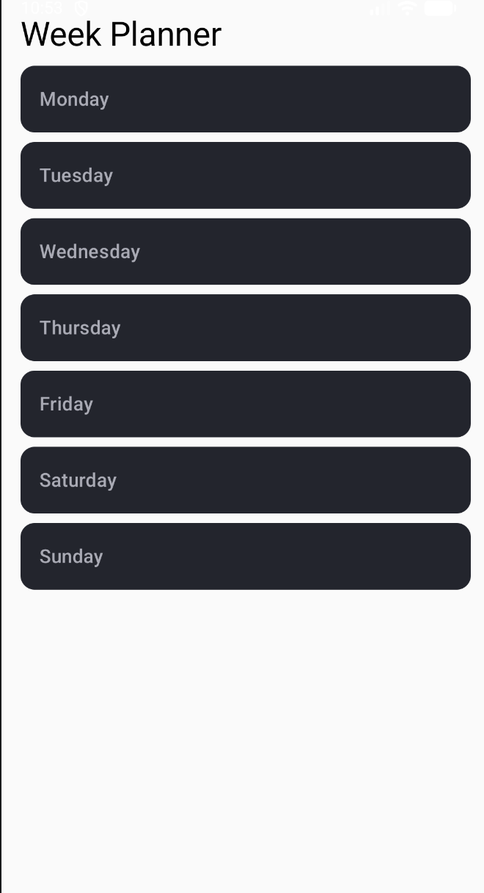
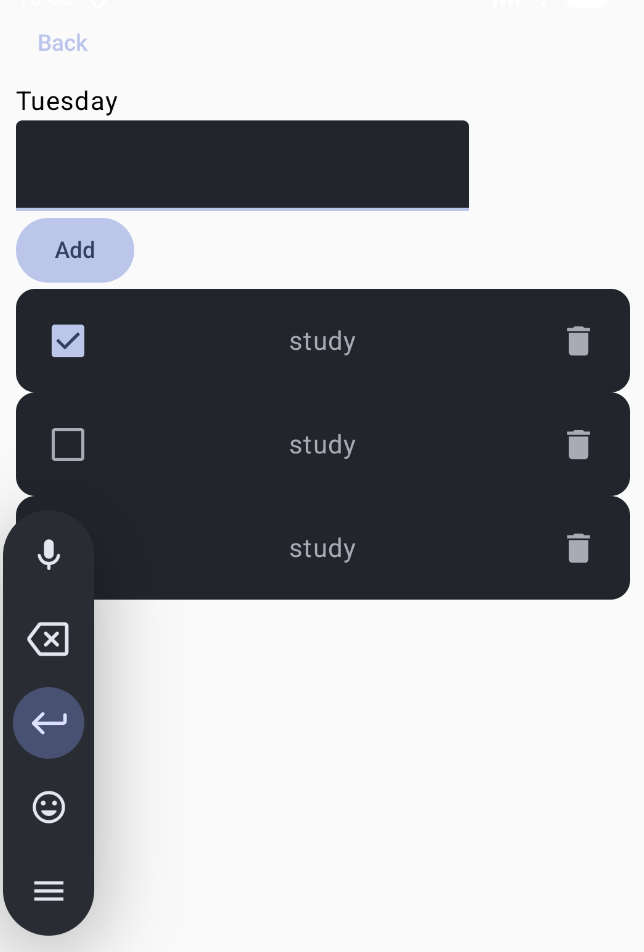

# WeekPlanner

## Description

WeekPlanner is an Android application for planning tasks by day of the week. The user picks a day, sees its tasks, adds new ones, marks them as done and deletes the ones that are no longer needed.

The app is built with Kotlin and Jetpack Compose as a group project (Weeks 12–14).

## Group Member

- Turgunbay Meiirbek


## Main Features

- List of 7 weekdays
- Task screen for the selected day
- Add a task
- Delete a task
- Mark a task as done
- Task list updates automatically when the state changes

## Tech Stack

- Kotlin
- Jetpack Compose
- Material 3
- Navigation Compose
- MVVM architecture
- StateFlow

## Screenshots

### Days screen



### Tasks screen



## Architecture

The app follows the **MVVM (Model-View-ViewModel)** pattern. UI, UI logic and data management are separated:

- **Model (`data/`)**: `Task` data class, `Days` list of weekdays and `TaskRepository`, which stores and manages the task list.
- **ViewModel (`viewmodel/`)**: `TaskViewModel` handles user actions (add, delete, mark as done) and exposes the UI state to the screens.
- **View (`ui/`)**: Composable screens and reusable components that only display the state and send user events to the ViewModel.

### State Management

UI state is held in the ViewModel using **StateFlow** and collected in Composables with `collectAsState()`. When the state changes, the UI is recomposed automatically. The ViewModel is shared between screens, so tasks are not lost when navigating.

## UI

- All UI is built with Jetpack Compose and Material 3.
- Reusable Composable functions (in `ui/components/`) are used to avoid duplicated code.
- Interactive components: buttons, text field for a new task, checkbox for completion, delete button.
- Consistent theme (colors, typography) is defined in `ui/theme/`.

## Navigation

Navigation is implemented with **Navigation Compose**. The app has two screens:

- `DaysScreen`: shows all 7 days of the week.
- `TasksScreen`: shows tasks of the selected day.

Details:

- **Argument passing:** the selected day is passed from `DaysScreen` to `TasksScreen` as a navigation argument.
- **Back navigation:** the user returns to the days list with the system Back button.

## Project Structure

```
WeekPlanner/
├── MainActivity.kt
├── data/
│   ├── Days.kt
│   ├── Task.kt
│   └── TaskRepository.kt
├── viewmodel/
│   └── TaskViewModel.kt
└── ui/
    ├── screens/
    ├── components/
    └── theme/
```

## How to Run

1. Clone the repository.
2. Open it in Android Studio.
3. Wait for Gradle to finish syncing.
4. Run the app on an emulator or an Android device.

## Limitations

- Tasks are stored in memory only, so they are lost when the app is closed.
- No editing of existing tasks.
- No notifications or reminders.
